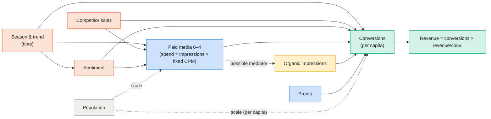

# Assumed causal structure (Task 1)

Colours: blue = treatments we want effects for, orange = confounders, yellow = possible mediator,
green = outcome, grey = scale. Source: `docs/dag.mmd` (Mermaid).

| Variable | Role | Why | In the model as |
|---|---|---|---|
| Paid media 0–4 | treatment | what the CMO controls | spend per capita → geometric adstock (8 weeks) → Hill saturation, geo-pooled effect |
| Impressions | duplicate of spend | cost per impression is constant to 3e-8 in every channel, so impressions carry no extra information | excluded |
| Season & trend | confounder | planners spend more in Q4 (Q4 ≈ 1.5× Q1) and demand moves with the calendar | shared smooth trend (knots every 8 weeks) + annual Fourier (3 harmonics); weekly fixed effects as a robustness check |
| Competitor sales | confounder | correlated 0.39–0.48 with Channel2/3/4 spend and with the KPI — planners react to competitors | linear, shared coefficient |
| Sentiment | confounder (likely) | correlated 0.24–0.40 with every channel; macro mood drives both budgets and buying | linear, shared; **sensitivity: drop it** (it could partly be a result of brand media) |
| Organic impressions | possible mediator | correlated 0.38–0.55 with paid; paid activity can generate organic reach | own adstock + saturation channel (the brief requires it); **sensitivity: drop it** — if paid ROIs rise, organic was absorbing paid effects |
| Promo | treatment (non-media) | little correlation with media (≤ 0.29) | linear, shared coefficient |
| Population | scale | geos range from 137k to 994k people | everything per capita |
| Revenue per conversion | outcome conversion | ≈ 0.0200, sd 0.0001 | revenue = modelled conversions × revenue per conversion |

**Rule applied:** adjust for confounders, not for mediators. Where a variable's role is ambiguous
(sentiment, organic) it is included as the brief asks and the ROI sensitivity to dropping it is
reported, so the reader sees how much the answer depends on that assumption.

**What the DAG cannot rule out:** unmeasured confounders that move both spend and sales in the
same geo-week (e.g. local events the planners knew about). Geo-level variation helps (65–79% of
spend variation is geo × week) but does not make the estimates experimental.
