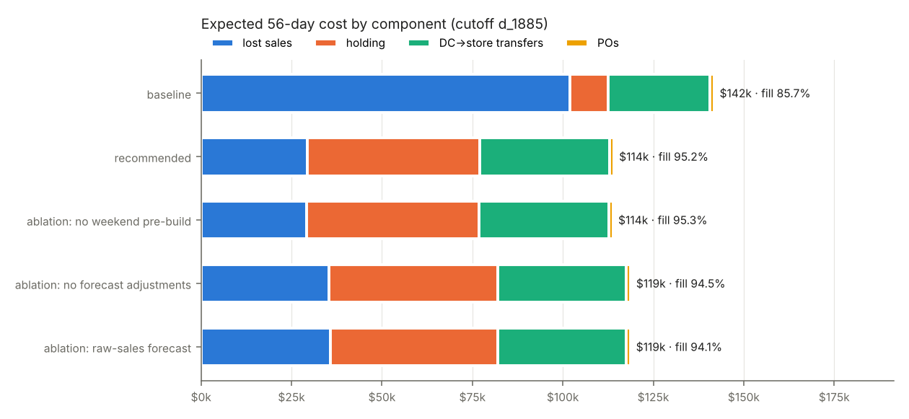

# Replenishment policy for California FOODS — recommendation

To: COO · From: Yaswanth Krishna · Scope: 1 DC → 4 CA stores, 1,437 FOODS items, 56 days from 28 Mar 2016 (data to 27 Mar) · All figures: 100 simulated runs; ranges are 5th–95th percentiles; source `reports/results_1885.md`

## Recommendation

Replace the current base-stock rule with a **forecast-driven, two-level policy**:

- **Stores, every day:** top each item up to what it will sell in the next 4 days in 99 out of 100 cases (99.5% for FOODS_1 and FOODS_3), never above the 21-day shelf limit. When the DC can't ship everything, ship first where a missing unit costs most (price × chance of running out).
- **DC, every Monday, per department:** order enough that the DC and the stores together stay stocked until the next supplier delivery lands, **assuming that delivery may be late**. A PO that is already overdue makes the next order bigger rather than being counted as stock on the shelf.
- Forecasts come from a model that corrects for days when shelves were empty, so it does not learn that "out of stock" means "no demand".

| 56 days | Current rule (base-stock) | **Recommended** | Lean variant¹ |
|---|---|---|---|
| Expected total cost | $141.8k ($119k–$178k) | **$114.1k ($95k–$150k)** | $95.6k |
| Fill rate (share of demand served) | 85.7% (79.4–89.7%) | **95.2% (89.5–98.0%)** | 94.8% |
| Chance of reaching 95% | 0% | **63%** | 63% |
| Lost-sale cost | $101.9k | $29.3k | $32.3k |
| Inventory left at the end (retail value) | $0.44M (13 days) | $1.50M (44 days) | $1.00M (29 days) |

**Savings: $27.8k (−20%) while serving 9.6 points more of demand.** Lost sales fall by $72k; we spend $37k more on holding stock and $8k more on DC→store shipping (we ship what we now sell).

**A decision for you — how much insurance to buy.** The recommended safety levels were set on the three *previous* 8-week periods (never on the period above). There they beat the lean variant by 0.8–1.4 fill points, and they are what kept the hard January–February period close to 95%. In this spring period both did about equally well on identical simulations (95.0% vs 94.8%), so the lean variant would have saved ~$19k. Recommended if 95% must hold in difficult months; lean if ~94.5–95% in those months is acceptable.

¹ Same policy with lower safety levels (97% store and DC targets, 3-day store cover); 40 runs.

## Why this works

A lost sale costs 35% of the price; holding the same unit costs 0.07% per day. **One lost sale costs as much as holding the unit for 511 days**, so the right policy keeps shelves full and pays for stock. What actually limits service is physical: the DC can ship only 13,442 units a day, while weekend demand runs ~14,300; suppliers deliver weekly with long, uncertain lead times (FOODS_3: 10 days on average, 17.5 days one time in twenty).

**Recorded sales understate demand.** Shelves were empty on ~4.5% of item-days, hiding ~5% of demand; correcting for this matters in money: driving the same policy with a forecast trained on raw sales costs **$4.7k more and loses 1.1 fill points** (chance of 95% falls from 63% to 50%). It also matters for *measuring* any policy: replaying recorded sales would overstate the current rule's fill by 3.5 points.

## Stress test: FOODS_3 lead times double for three weeks

| | Current rule | Recommended | Lean variant |
|---|---|---|---|
| No warning | **−6.4 fill points, +$32.9k** | −0.1 points, −$0.9k | −0.6 points, +$1.8k |
| Two weeks' warning | same (rule can't use it) | +$2.2k, no fill change | −0.1 points, +$2.7k |

The recommended policy already holds 30–40 days of cover at the DC, so a 10-day slip is absorbed; the lean variant loses 0.6 points without warning and recovers almost all of it with warning. **With two weeks' notice:** (1) feed the new lead time into the Monday orders for the two weeks before (the policy does this automatically and pre-buys); (2) pre-position FOODS_3 in stores on weekdays, when DC→store capacity is spare; (3) don't over-react — with the recommended settings, extra pre-buying added $2.2k for no service gain; the warning is worth most to a lean policy. The current rule has no buffer and loses 6 points of fill.

## Three biggest risks

1. **A slow first delivery.** We start with 7 days of stock and nothing on order. If the first FOODS_3 PO takes ~18+ days, daily fill drops to ~70% in weeks 2–3 whatever we order. This, not the policy, is why the chance of reaching 95% is 63% rather than ~100%. *Fix: start with stock on order, or expedite the first FOODS_3 PO.*
2. **The DC outbound limit and the 21-day shelf limit.** The limit is set on recorded sales and sits below weekend demand; the shelf limit uses last year's average, which starves growing items (e.g. CA_2 doubled its volume in 2015) and items restarting after a gap — about 45% of the sales we still lose once operations settle. *Fix: review both limits against true demand.*
3. **Demand we can't see.** Shelves that empty mid-afternoon still record some sales and can't be detected; demand rebounds the model hasn't seen (January ran 9% above forecast in testing); items Walmart restocks after months off. *Mitigation: the safety levels absorb part of it; better data removes it.*

**Also note:** the policy ends the window holding $1.5M of stock. That stock supports sales after day 56 and is cheap to hold (included in the cost above), but it is ~$1M more than the current rule leaves (the lean variant: ~$0.5M more). If that is a constraint, use the lean variant.

## Where the money goes

The recommended policy swaps lost sales for holding cost. Turning off the forecast's corrections, or training it on raw sales, each costs ~$4.7k and ~1 fill point; the weekend pre-ship rule adds nothing once stores keep 4 days of cover (left in as a safeguard).

## What this analysis cannot tell you

Whether the inferred stockouts are right item by item (there is no on-hand data to check them), how lead times really vary (we used the spread you specified), and how demand reacts to promotions we cannot see.

## Data we would need

Daily on-hand and out-of-stock flags per item-store (to replace the inferred stockouts); history of actual supplier lead times per PO (we assumed a fixed spread); the promotion calendar; planned launches and delistings; true DC daily shipping capacity.
