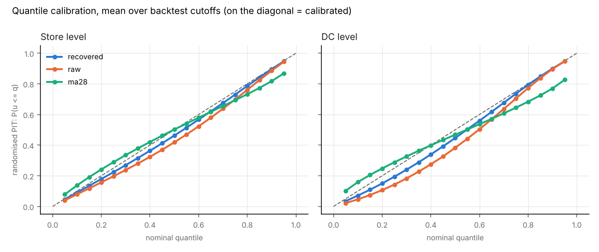

# Forecast backtests

Auto-generated by `python -m project_a.backtest`. Scored on uncensored days only.
bias = actual / forecast (>1 means under-forecast); spl = mean pinball loss over 19 quantiles / mean demand.

## STORE level

| cutoff | model | bias | WAPE | scaled pinball | 50% cov | 90% cov |
|---|---|---|---|---|---|---|
| d_1801 | recovered | 1.090 | 0.638 | 0.236 | 0.75 | 0.95 |
| d_1801 | raw | 1.156 | 0.643 | 0.244 | 0.75 | 0.95 |
| d_1801 | ma28 | 1.184 | 0.692 | 0.269 | 0.66 | 0.86 |
| d_1829 | recovered | 1.044 | 0.624 | 0.227 | 0.76 | 0.96 |
| d_1829 | raw | 1.084 | 0.629 | 0.233 | 0.75 | 0.96 |
| d_1829 | ma28 | 1.099 | 0.634 | 0.239 | 0.67 | 0.88 |
| d_1857 | recovered | 0.999 | 0.641 | 0.230 | 0.77 | 0.96 |
| d_1857 | raw | 1.057 | 0.636 | 0.234 | 0.74 | 0.96 |
| d_1857 | ma28 | 1.069 | 0.654 | 0.247 | 0.66 | 0.88 |

## DC level

| cutoff | model | bias | WAPE | scaled pinball | 50% cov | 90% cov |
|---|---|---|---|---|---|---|
| d_1801 | recovered | 1.094 | 0.358 | 0.139 | 0.63 | 0.93 |
| d_1801 | raw | 1.157 | 0.373 | 0.148 | 0.64 | 0.94 |
| d_1801 | ma28 | 1.183 | 0.444 | 0.184 | 0.45 | 0.75 |
| d_1829 | recovered | 1.055 | 0.347 | 0.133 | 0.66 | 0.95 |
| d_1829 | raw | 1.091 | 0.357 | 0.141 | 0.68 | 0.95 |
| d_1829 | ma28 | 1.104 | 0.376 | 0.150 | 0.48 | 0.79 |
| d_1857 | recovered | 1.005 | 0.364 | 0.137 | 0.65 | 0.94 |
| d_1857 | raw | 1.058 | 0.366 | 0.143 | 0.67 | 0.95 |
| d_1857 | ma28 | 1.052 | 0.392 | 0.157 | 0.48 | 0.79 |

## Store level by department (mean over cutoffs)

| dept | model | bias | WAPE | scaled pinball | 90% cov |
|---|---|---|---|---|---|
| FOODS_1 | recovered | 1.027 | 0.736 | 0.263 | 0.95 |
| FOODS_1 | raw | 1.114 | 0.732 | 0.268 | 0.95 |
| FOODS_1 | ma28 | 1.083 | 0.759 | 0.287 | 0.86 |
| FOODS_2 | recovered | 1.030 | 0.741 | 0.260 | 0.97 |
| FOODS_2 | raw | 1.089 | 0.741 | 0.267 | 0.96 |
| FOODS_2 | ma28 | 1.099 | 0.759 | 0.276 | 0.90 |
| FOODS_3 | recovered | 1.053 | 0.587 | 0.217 | 0.96 |
| FOODS_3 | raw | 1.103 | 0.591 | 0.224 | 0.95 |
| FOODS_3 | ma28 | 1.131 | 0.616 | 0.239 | 0.86 |

