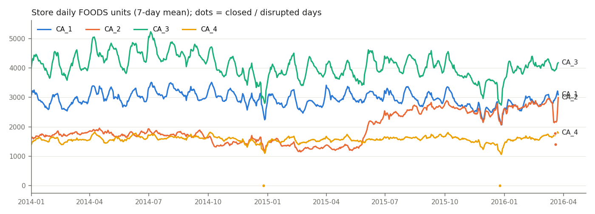
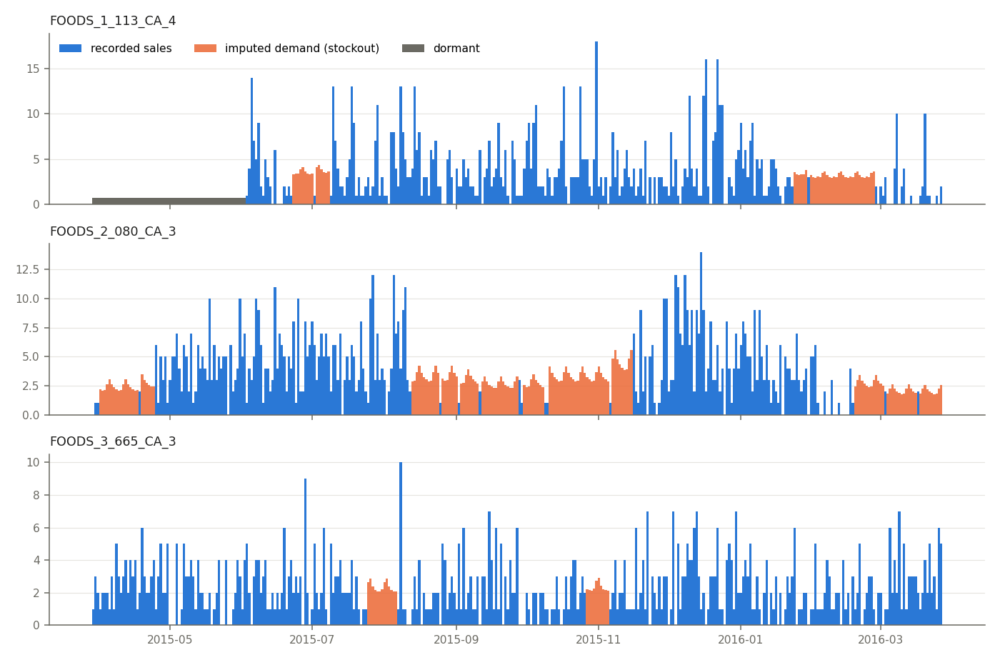

# Data audit (cutoff d_1885)

Auto-generated by `python -m project_a.audit_data`. Interpretation lives in DATA_ISSUES.md.

## Status of every series-day (d_1 .. cutoff)

| status | share |
|---|---|
| ok | 61.3% |
| prelaunch | 0.2% |
| unlisted | 23.7% |
| closed | 0.2% |
| disrupted | 0.0% |
| stockout | 4.5% |
| dormant | 10.0% |

## Last 365 days before cutoff

| group | stockout days | dormant days | demand hidden by stockouts |
|---|---|---|---|
| FOODS_1 | 6.6% | 10.1% | 7.4% |
| FOODS_2 | 4.9% | 9.4% | 5.4% |
| FOODS_3 | 5.7% | 11.5% | 7.2% |
| CA_1 | 5.9% | 12.8% | 6.7% |
| CA_2 | 4.3% | 11.8% | 5.7% |
| CA_3 | 8.1% | 4.8% | 8.2% |
| CA_4 | 4.2% | 13.3% | 5.5% |

## Status on the cutoff day (inherited by the policy)

{"ok": 5272, "prelaunch": 0, "unlisted": 0, "closed": 0, "disrupted": 0, "stockout": 317, "dormant": 159}

## Test window d_1886..d_1941 (recorded sales are censored too)

Recorded units 665,355; recovered demand 702,889; hidden share 5.3%. Stockout days 4.4%, dormant 3.2%.

## DC outbound capacity

Cap = 1.25 x 10,754 = 13,442 units/day. Recovered demand averages 11,548/day. Days above cap in last 365: recorded 49, recovered 73.

Recovered network demand by weekday (Mon=0): 0: 11,218, 1: 10,235, 2: 10,015, 3: 10,069, 4: 11,040, 5: 13,867, 6: 14,338

## Detector validation

Recall on planted stockouts (share of planted days flagged):

| band   |    1 |    3 |    7 |   14 |
|:-------|-----:|-----:|-----:|-----:|
| 0-0.5  | 0.03 | 0.03 | 0.11 | 0.35 |
| 0.5-2  | 0.04 | 0.06 | 0.5  | 0.92 |
| 2-5    | 0.04 | 0.44 | 0.96 | 1    |
| 5-inf  | 0.21 | 0.86 | 1    | 1    |

Imputed / true units on fully detected planted runs:

| band   |    1 |    3 |    7 |   14 |
|:-------|-----:|-----:|-----:|-----:|
| 0-0.5  | 0.35 | 0.79 | 1.14 | 1.05 |
| 0.5-2  | 0.71 | 0.94 | 0.99 | 1.01 |
| 2-5    | 1    | 0.99 | 0.97 | 1    |
| 5-inf  | 1.02 | 1.01 | 1    | 0.95 |

False-alarm share of days on simulated stockout-free series:

| band   |   mean |   count |
|:-------|-------:|--------:|
| 0-0.5  | 0.0198 |      53 |
| 0.5-2  | 0.0076 |     262 |
| 2-5    | 0.0042 |     122 |
| 5-inf  | 0.0018 |      59 |

