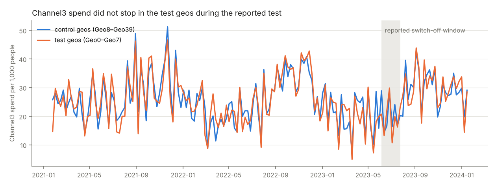

# Project B data audit

Auto-generated by `python -m project_b.audit`.

40 geos x 156 weeks (2021-01-25 to 2024-01-15), no missing values.

## Channels

| channel | cost / impression | CV of cost/impr. | zero-spend geo-weeks | total spend | last 13 weeks |
|---|---|---|---|---|---|
| Channel0 | 0.00733 | 3.3e-08 | 12.1% | 40.5M | 3.80M |
| Channel1 | 0.00964 | 3.3e-08 | 27.9% | 31.3M | 3.20M |
| Channel2 | 0.00743 | 3.5e-08 | 64.3% | 12.1M | 1.44M |
| Channel3 | 0.00779 | 3.3e-08 | 2.7% | 87.9M | 7.95M |
| Channel4 | 0.00779 | 3.3e-08 | 13.1% | 47.7M | 4.37M |

## Where spend varies (share of variance of weekly spend per capita)

| channel | common week | geo | geo x week | CV of 3-year spend per capita across geos |
|---|---|---|---|---|
| Channel0 | 21.1% | 0.6% | 78.3% | 0.06 |
| Channel1 | 23.0% | 0.4% | 76.5% | 0.07 |
| Channel2 | 20.3% | 0.4% | 79.3% | 0.13 |
| Channel3 | 34.7% | 0.5% | 64.8% | 0.04 |
| Channel4 | 29.0% | 0.4% | 70.6% | 0.05 |

Budget: last 13 weeks 20.77M -> +-30% range 14.54M to 26.99M.

## Experiment check (Channel3, Geo0–Geo7, 8 weeks from 2023-06-05)

- Zero-spend geo-weeks in the window: **2 of 64**
- Test-geo Channel3 spend per 1,000 people: window 19.47 vs previous 8 weeks 17.89
- Test / control spend ratio: before 0.88, during 0.94, all other weeks 1.00
- Difference-in-differences of Channel3 spend per capita (test − control, window − pre): +0.0012
- Difference-in-differences of revenue per capita: -0.01583

