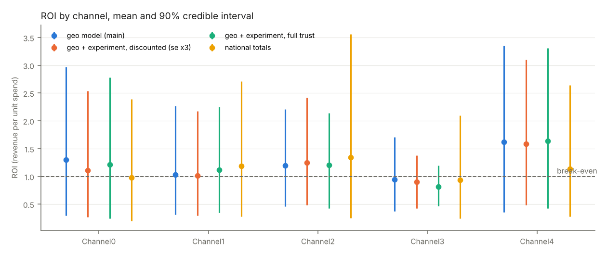
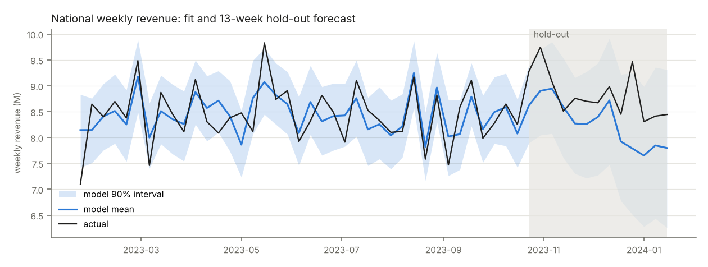
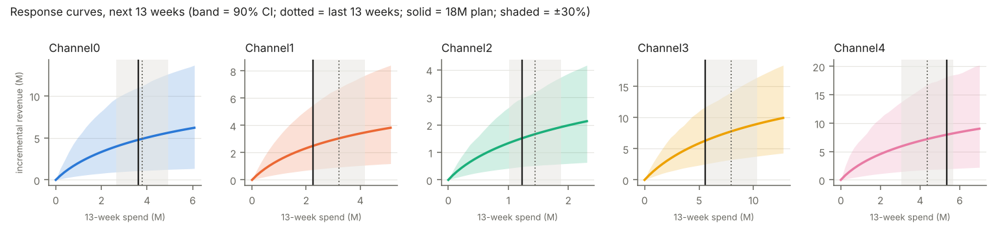

# Project B results — hold-out 2023-10-23 to 2024-01-15

Trained on 2021-01-25 – 2023-10-16. Generated by `python -m project_b.run_project_b`. 90% credible intervals in brackets. ROI = incremental revenue ÷ spend over the last 52 training weeks (carry-over included); marginal ROI = revenue from the next 1% of spend ÷ that spend.

## ROI by channel (main model)

| channel | spend (52w) | ROI | marginal ROI | P(ROI > 1) |
|---|---|---|---|---|
| Channel0 | 13.76M | 1.30 [0.29, 2.97] | 0.64 [0.12, 1.46] | 0.55 |
| Channel1 | 10.00M | 1.03 [0.31, 2.27] | 0.54 [0.14, 1.17] | 0.40 |
| Channel2 | 4.03M | 1.20 [0.46, 2.21] | 0.71 [0.20, 1.41] | 0.55 |
| Channel3 | 28.55M | 0.94 [0.38, 1.71] | 0.51 [0.20, 0.95] | 0.36 |
| Channel4 | 15.37M | 1.62 [0.36, 3.35] | 0.77 [0.16, 1.47] | 0.73 |

## ROI across model variants (mean [90% CI])

| channel | geo model (main) | geo + experiment, discounted (se x3) | geo + experiment, full trust | national totals | geo, weekly fixed effects | geo, without sentiment | geo, without organic |
|---|---|---|---|---|---|---|---|
| Channel0 | 1.30 [0.29, 2.97] | 1.11 [0.27, 2.54] | 1.22 [0.25, 2.78] | 0.98 [0.20, 2.39] | 1.17 [0.26, 2.82] | 0.94 [0.17, 2.22] | 1.35 [0.34, 3.05] |
| Channel1 | 1.03 [0.31, 2.27] | 1.02 [0.29, 2.18] | 1.12 [0.35, 2.25] | 1.18 [0.28, 2.71] | 1.06 [0.31, 2.38] | 0.89 [0.23, 2.04] | 1.13 [0.38, 2.49] |
| Channel2 | 1.20 [0.46, 2.21] | 1.25 [0.49, 2.42] | 1.21 [0.42, 2.14] | 1.34 [0.25, 3.56] | 1.31 [0.47, 2.29] | 0.62 [0.09, 1.20] | 1.34 [0.38, 2.43] |
| Channel3 | 0.94 [0.38, 1.71] | 0.90 [0.42, 1.38] | 0.81 [0.46, 1.19] | 0.94 [0.24, 2.09] | 0.90 [0.35, 1.62] | 0.28 [-0.06, 0.70] | 1.00 [0.39, 1.70] |
| Channel4 | 1.62 [0.36, 3.35] | 1.58 [0.49, 3.11] | 1.64 [0.42, 3.31] | 1.13 [0.28, 2.64] | 1.97 [0.52, 4.21] | 2.23 [0.67, 4.41] | 1.52 [0.36, 3.23] |

Model-implied iROAS of the reported Channel3 test (Geo0–7, 8 weeks + carry-over), vs vendor 0.8 [0.3, 1.3]: geo model (main) 1.10 [0.38, 2.01]; geo + experiment, discounted (se x3) 0.96 [0.41, 1.63]; geo + experiment, full trust 0.86 [0.49, 1.26]; geo, weekly fixed effects 0.94 [0.32, 1.79]; geo, without sentiment 0.35 [-0.54, 1.20]; geo, without organic 1.10 [0.40, 1.89]

## Hold-out forecast accuracy (13 weeks)

| level | WAPE | MAPE | R² | bias | 90% interval coverage |
|---|---|---|---|---|---|
| national | 0.063 | 0.063 | -1.458 | -6.2% | 0.85 |
| geo | 0.219 | 0.270 | 0.727 | -6.2% | 0.86 |

In-sample (last 52 training weeks): national WAPE 0.034, R² 0.479, coverage 0.92.

## Budget — next 13 weeks

| scenario | Channel0 | Channel1 | Channel2 | Channel3 | Channel4 | total | incremental revenue | uplift vs today's mix | P(uplift > 0) |
|---|---|---|---|---|---|---|---|---|---|
| 12M (±30% floor) | 2.66M (-30%) | 2.24M (-30%) | 1.01M (-30%) | 5.56M (-30%) | 3.06M (-30%) | 14.54M | 20.03M [12.86, 29.28] | — (today's mix by construction) | — |
| 12M relaxed | 2.47M (-35%) | 1.28M (-60%) | 0.79M (-45%) | 3.58M (-55%) | 3.88M (-11%) | 12.00M | 18.12M [10.92, 27.12] | 361k [-1,248, 2,082] | 0.61 |
| 18M | 3.61M (-5%) | 2.24M (-30%) | 1.23M (-15%) | 5.56M (-30%) | 5.36M (+23%) | 18.00M | 23.03M [14.57, 33.05] | 316k [-1,092, 1,764] | 0.63 |
| 24M | 4.94M (+30%) | 3.04M (-5%) | 1.88M (+30%) | 8.46M (+6%) | 5.69M (+30%) | 24.00M | 26.77M [17.38, 38.41] | 207k [-567, 957] | 0.67 |

Calibrated-model allocations at 18M (sensitivity): full: Channel0 3.23M, Channel1 2.24M, Channel2 1.44M, Channel3 5.56M, Channel4 5.52M; discounted: Channel0 3.50M, Channel1 2.24M, Channel2 1.23M, Channel3 5.56M, Channel4 5.47M

## Value of information and next experiment

EVPI (all channels) at 18M: 895k. Per channel (EVPPI): Channel0 339k, Channel1 180k, Channel2 127k, Channel3 216k, Channel4 337k. Next test: **Channel0**.

| treated geos | weeks | spend change | power | MDE (iROAS) | spend moved |
|---|---|---|---|---|---|
| 20 | 16 | -100% | 0.32 | 2.70 | -1,963k |
| 20 | 12 | -100% | 0.29 | 2.94 | -1,484k |
| 10 | 16 | -100% | 0.28 | 2.91 | -981k |
| 10 | 12 | -100% | 0.23 | 3.66 | -740k |
| 20 | 8 | -100% | 0.21 | 3.73 | -1,014k |
| 20 | 12 | +200% | 0.19 | 1.52 | 2,968k |
| 10 | 12 | +200% | 0.18 | 1.72 | 1,496k |
| 10 | 16 | +200% | 0.18 | 1.42 | 1,966k |
| 10 | 8 | -100% | 0.18 | 4.33 | -499k |
| 20 | 16 | +200% | 0.17 | 1.16 | 3,916k |
| 20 | 8 | +100% | 0.16 | 3.87 | 996k |
| 10 | 8 | +200% | 0.15 | 2.19 | 1,003k |
| 10 | 8 | +100% | 0.15 | 4.36 | 500k |
| 10 | 12 | +100% | 0.14 | 3.58 | 735k |
| 20 | 8 | +200% | 0.14 | 1.78 | 1,985k |
| 20 | 16 | +100% | 0.14 | 2.54 | 1,985k |
| 20 | 12 | +100% | 0.14 | 3.01 | 1,482k |
| 10 | 16 | +100% | 0.13 | 2.89 | 986k |

## Convergence (worst R-hat / min ESS per variant)

- geo model (main): R-hat ≤ 1.039, ESS ≥ 143
- geo + experiment, discounted (se x3): R-hat ≤ 1.042, ESS ≥ 144
- geo + experiment, full trust: R-hat ≤ 1.036, ESS ≥ 152
- national totals: R-hat ≤ 1.036, ESS ≥ 66
- geo, weekly fixed effects: R-hat ≤ 1.091, ESS ≥ 13
- geo, without sentiment: R-hat ≤ 1.106, ESS ≥ 11
- geo, without organic: R-hat ≤ 1.054, ESS ≥ 45

Prior-predictive media share of conversions: median 0.24 [0.13, 0.59].

Runtime: 22.2 min.

