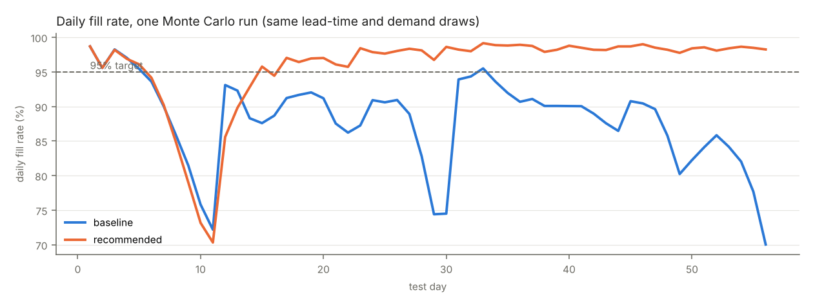
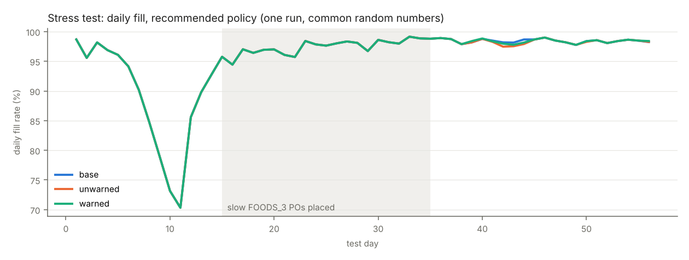

# Project A results — cutoff d_1885 (test d_1886–d_1941)

Monte Carlo over lead-time draws and censored-day demand draws; 100 runs per policy (sensitivity rows fewer). Ranges are 5th–95th percentiles. Generated by `python -m project_a.run_project_a`.

## Policies

| policy | total cost (mean) | 5–95% | fill rate | 5–95% | P(fill ≥ 95%) | lost | holding | transfer | PO | ending inventory |
|---|---|---|---|---|---|---|---|---|---|---|
| baseline | $141,847 | $119,233–$177,614 | 85.7% | 79.4%–89.7% | 0.00 | $101,865 | $10,664 | $28,118 | $1,200 | $442,147 |
| recommended | $114,052 | $94,724–$149,777 | 95.2% | 89.5%–98.0% | 0.63 | $29,307 | $47,634 | $35,917 | $1,194 | $1,503,749 |
| ablation: no weekend pre-build | $113,830 | $94,480–$149,686 | 95.3% | 89.5%–98.0% | 0.64 | $29,268 | $47,646 | $35,721 | $1,194 | $1,503,762 |
| ablation: no forecast adjustments | $118,781 | $100,053–$153,825 | 94.5% | 88.9%–97.2% | 0.58 | $35,325 | $46,621 | $35,637 | $1,197 | $1,480,567 |
| ablation: raw-sales forecast | $118,741 | $99,505–$154,374 | 94.1% | 88.4%–96.9% | 0.50 | $35,822 | $46,252 | $35,466 | $1,200 | $1,457,533 |
| sensitivity: recorded test sales as demand | $105,781 | $92,105–$131,385 | 96.4% | 92.0%–98.4% | 0.80 | $22,321 | $47,514 | $34,745 | $1,200 | $1,498,043 |
| sensitivity: baseline, recorded test sales | $113,187 | $92,620–$148,553 | 89.2% | 82.5%–93.0% | 0.00 | $72,534 | $11,390 | $28,063 | $1,200 | $482,973 |

Fill by department (mean): baseline: 86.3% / 88.4% / 84.9%; recommended: 97.3% / 98.0% / 94.2%; ablation: no weekend pre-build: 97.3% / 98.0% / 94.2%; ablation: no forecast adjustments: 95.4% / 97.5% / 93.6%; ablation: raw-sales forecast: 95.8% / 97.4% / 93.0%

Rule violations cut by the simulator (mean per run): baseline: 16204, recommended: 0, ablation: no weekend pre-build: 0, ablation: no forecast adjustments: 0, ablation: raw-sales forecast: 0, sensitivity: recorded test sales as demand: 0, sensitivity: baseline, recorded test sales: 17521

Knobs used: `{"alpha_store": {"FOODS_1": 0.995, "FOODS_2": 0.99, "FOODS_3": 0.995}, "beta_dc": {"FOODS_1": 0.99, "FOODS_2": 0.97, "FOODS_3": 0.995}, "store_window": 4, "prebuild": true, "lookahead_days": 6, "cap_eta": 0.97, "future_orders": 4, "store_buffer": 1.5}`

## Stress test — FOODS_3 lead times x2 for POs placed in weeks 3–5

| scenario | policy | cost | 5–95% | Δ cost vs base | fill | Δ fill | FOODS_3 fill | DC holding | ending inventory |
|---|---|---|---|---|---|---|---|---|---|
| base | recommended | $114,052 | $94,724–$149,777 | $0 | 95.2% | +0.0 pts | 94.2% | $38,445 | $1,503,749 |
| unwarned | recommended | $113,115 | $93,358–$146,905 | $-937 | 95.1% | -0.1 pts | 94.0% | $36,727 | $1,519,723 |
| warned | recommended | $116,291 | $98,564–$145,308 | $2,238 | 95.2% | -0.0 pts | 94.2% | $40,459 | $1,516,181 |
| base | baseline | $138,676 | $122,738–$160,736 | $0 | 86.2% | +0.0 pts | 85.7% | $7,907 | $443,909 |
| unwarned | baseline | $171,603 | $145,198–$206,064 | $32,927 | 79.8% | -6.4 pts | 75.5% | $6,513 | $405,442 |
| warned | baseline | $171,603 | $145,198–$206,064 | $32,927 | 79.8% | -6.4 pts | 75.5% | $6,513 | $405,442 |

Runtime (s): audit 36, backtest 176, forecast 58, simulate 2205, stress 1294, total 3768

